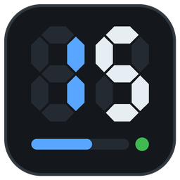

<div align="center">


# War Thunder Sim Assist

**A tiny always-on-top period timer for War Thunder Simulator battles.**

*Simülatör maçları için küçük, her zaman üstte duran periyot kronometresi.*

[English](#english) · [Türkçe](#türkçe)
</div>

> **Unofficial fan tool.** Not affiliated with, endorsed by or sponsored by Gaijin Entertainment. "War Thunder" is a trademark of Gaijin Entertainment.
> *Resmî olmayan bir hayran aracıdır; Gaijin Entertainment ile bağlantılı değildir.*

---

## English

### What it does
- Starts counting **automatically the moment you spawn** in a battle.
- Shows `PERIOD / MM:SS` in a digital-clock style, e.g. `1 / 00:25`. A period is 15 minutes (configurable); when it ends the period number goes up and the clock restarts from `00:00`.
- **Periods are kept across deaths.** If you die in minute 5 and respawn, you continue at `2 / 00:00`. Going back to the hangar or joining a new battle starts again from `1`.
- When you die the counter freezes and turns red.
- Transparent background (only the digits are visible), several sizes, draggable, remembers its position.

### Download
Go to the **[Releases](../../releases)** page and pick one:
- `WarThunderSimAssist-Setup-x.y.z.exe` – installer (Start Menu + desktop icon).
- `WarThunderSimAssist-portable-x.y.z.zip` – unzip anywhere and run `WarThunderSimAssist.exe`.

**Windows SmartScreen warning:** the app is not code-signed, so Windows may say *"Windows protected your PC"*. Click **More info → Run anyway**. Some antivirus programs also flag any program packaged with PyInstaller by mistake. You do not have to trust the binary blindly: the full source is in this repository and the releases are built from it automatically by GitHub Actions (see [`.github/workflows/build.yml`](.github/workflows/build.yml)).

### How to use
1. Start the program, then start War Thunder in **Windowed** or **Borderless windowed** mode. A true *Fullscreen* mode hides every desktop window, including this one.
2. Drag the digits to where you want them. Right-click the digits for the menu (size, period length, background, quit …).
3. Spawn in. The timer starts by itself.

Tip: in the transparent mode clicks on empty space pass through to the game, so grab the **digits** to drag or open the menu. For easier positioning switch *Background → Dark* temporarily.

### How it works / is it safe?
The program only reads the **local telemetry web interface that War Thunder itself provides** at `http://localhost:8111` (the same data community tools like map viewers use). It does **not** read or modify the game's memory or files, does not inject anything, and does not send any data anywhere. Use at your own risk; this is an unofficial tool.

### Settings & logs
Stored in `%LOCALAPPDATA%\WarThunderSimAssist` (right-click → *Open data folder*). If the timer behaves strangely, right-click → *Save telemetry info* and attach `wt_telemetri_log.txt` to an issue.

### Build from source
```bat
build.bat
```
Needs Python 3.8+ with tkinter. You can also just run `python src/warthunder_sim_assist.py` (no extra packages). To publish a release: update `SURUM` in the source, then push a tag such as `v1.0.1` – GitHub Actions builds the installer and the zip and attaches them to a Release.

### License
MIT – see [LICENSE](LICENSE).

---

## Türkçe

### Ne yapar?
- Bir maçta **doğduğunuz anda otomatik olarak** saymaya başlar.
- `PERİYOT / DD:SS` biçiminde dijital saat görünümüyle gösterir, örn. `1 / 00:25`. Bir periyot 15 dakikadır (ayarlanabilir); bitince periyot numarası artar ve süre `00:00`'dan yeniden başlar.
- **Periyotlar ölümlerde korunur.** 5. dakikada ölüp yeniden doğarsanız `2 / 00:00` ile devam eder. Hangara dönünce veya yeni maça girince yeniden `1`'den başlar.
- Öldüğünüzde sayaç donar ve kırmızı olur.
- Şeffaf arka plan (yalnızca rakamlar görünür), birkaç boyut, sürüklenebilir, konumu hatırlar.

### İndirme
**[Releases](../../releases)** sayfasından birini seçin:
- `WarThunderSimAssist-Setup-x.y.z.exe` – kurulum dosyası (Başlat menüsü ve masaüstü ikonu).
- `WarThunderSimAssist-portable-x.y.z.zip` – istediğiniz yere çıkarıp `WarThunderSimAssist.exe`'yi çalıştırın.

**Windows SmartScreen uyarısı:** Program kod imzalı olmadığı için Windows *"Windows bilgisayarınızı korudu"* diyebilir. **Ek bilgi → Yine de çalıştır** deyin. Bazı antivirüsler PyInstaller ile paketlenmiş her programı yanlışlıkla şüpheli bulabilir. Dosyaya körü körüne güvenmeniz gerekmez: kaynak kodun tamamı bu depoda ve sürümler GitHub Actions ile bu koddan otomatik derlenir ([`build.yml`](.github/workflows/build.yml)).

### Kullanım
1. Programı açın, sonra War Thunder'ı **Pencere** veya **Kenarlıksız pencere** modunda başlatın. Gerçek *Tam ekran* modu bu pencere dahil hiçbir masaüstü penceresini göstermez.
2. Rakamları istediğiniz yere sürükleyin. Menü için rakamlara sağ tıklayın (boyut, periyot süresi, arka plan, kapat …).
3. Doğun. Sayaç kendiliğinden başlar.

İpucu: Şeffaf modda boş alana yapılan tıklamalar oyuna geçer; sürüklemek ve menüyü açmak için **rakamları** tutun. Yerleştirmeyi kolaylaştırmak için geçici olarak *Arka plan → Koyu* seçebilirsiniz.

### Nasıl çalışır / güvenli mi?
Program yalnızca War Thunder'ın **kendi sunduğu yerel telemetri arayüzünü** (`http://localhost:8111`) okur; harita araçları gibi topluluk programlarının kullandığı aynı veridir. Oyunun belleğini veya dosyalarını **okumaz, değiştirmez**, hiçbir şey enjekte etmez ve hiçbir yere veri göndermez. Resmî olmayan bir araçtır, kullanım sorumluluğu size aittir.

### Ayarlar ve günlükler
`%LOCALAPPDATA%\WarThunderSimAssist` klasöründe tutulur (sağ tık → *Veri klasörünü aç*). Sayaç beklenmedik davranırsa sağ tık → *Telemetri bilgisini kaydet* ile oluşan `wt_telemetri_log.txt` dosyasını bir issue'ya ekleyin.

### Kaynaktan derleme
`build.bat` çalıştırın (Python 3.8+ ve tkinter gerekir). Ya da doğrudan `python src/warthunder_sim_assist.py` ile çalıştırabilirsiniz (ek paket yok). Sürüm yayınlamak için koddaki `SURUM` değerini güncelleyin, sonra `v1.0.1` gibi bir etiket gönderin; GitHub Actions kurulum dosyasını ve zip'i derleyip Release'e ekler.

### Lisans
MIT – bkz. [LICENSE](LICENSE).
